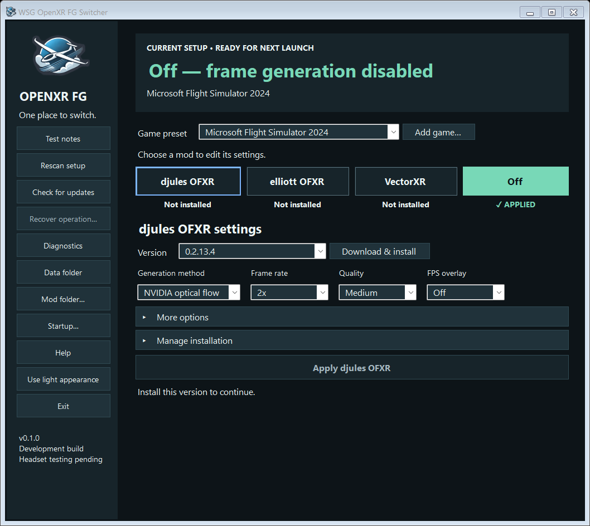

# WSG OpenXR FG Switcher

A Windows x64 desktop app for configuring and switching between djules OFXR,
elliott OFXR, VectorXR, and Off. Includes WSG dark/light themes, per-game presets,
guided official downloads, version selection, comparison notes, and recovery.

**Public preview 0.1.0.** Save a different mod, version and settings for each game,
then apply that game's preset before launching it. One setup is active at a time.
Headset validation is still pending; no combination is labelled headset-tested.
Published builds check for signed app updates automatically and install only when
idle. Updates wait while a game or provider operation is in progress.

[Download the preview](https://github.com/siglr/WSGOpenXRFGSwitcher/releases/tag/v0.1.0)
· [Website and setup guide](https://wesimglide.org/otherdata/tools/WSG-OpenXR-FG-Switcher.html)
· [Report a problem](https://github.com/siglr/WSGOpenXRFGSwitcher/issues)



## Run

Extract the complete application ZIP into a writable folder outside game
installations. Launch **WSG OpenXR FG Switcher.exe** normally, without administrator
rights. Requires **Microsoft .NET 10 Desktop Runtime for Windows x64**, installed
once from [Microsoft's .NET 10 downloads](https://dotnet.microsoft.com/en-us/download/dotnet/10.0).
Choose **.NET Desktop Runtime → Windows → x64**, not the SDK or ASP.NET runtime.
The app-only ZIP contains WSG binaries and documentation; it does not bundle .NET.
Windows' older .NET Framework and .NET 8/9 do not satisfy this requirement.
Source builds require the .NET 10 SDK.

### Startup and flight launch scripts

Choose **Startup…** in the sidebar to save a default **game preset and mod**.
The selected game's saved version, settings and coexistence choice are used.
**Apply this preset when WSG starts** and **Start in tray** are
independent, optional choices; both are off by default. Startup errors restore
the window. Neither option starts the game.

`--tray` (aliases `--minimized` and `--start-minimized`) starts the normal app in the tray for
that session. It applies a setup only if the saved Apply-on-launch option is on.
Restore the window through WSG's notification-area icon.

For a launcher, prefer **`--apply-default`**. It applies the saved default once,
then exits **without provider cleanup**, leaving the setup ready for the game.
There is no WSG background process afterward. Close an existing WSG instance
first. Wait for a successful exit before the launch script starts MSFS:

```powershell
$switcher = 'C:\path\to\WSG OpenXR FG Switcher.exe'
$apply = Start-Process -FilePath $switcher -ArgumentList '--apply-default' -Wait -PassThru
if ($apply.ExitCode -ne 0) {
    throw "WSG setup failed (code $($apply.ExitCode)). See startup-result.json in the WSG Data folder."
}
# Your existing MSFS launch commands follow here.
```

Alternatively, explicitly choose a saved game and provider:

```text
"WSG OpenXR FG Switcher.exe" --game "Microsoft Flight Simulator 2024" --provider djules
```

Providers: `off`, `djules`, `elliott`, `vectorxr`. Game selection accepts the exact
preset name, executable path, or preset ID. Ambiguous names are rejected. The
command uses the saved version; it never downloads or substitutes a version.
Use either `--apply-default` or `--game` with `--provider`. Combining an apply
command with `--tray` (or either alias) still performs a one-shot apply with no main window.

Exit codes: **0** applied; **1** failed; **2** invalid arguments; **3** WSG already
running. Apply commands write `startup-result.json` under
`%LOCALAPPDATA%\WSG OpenXR FG Switcher`; `--result "C:\absolute\result.json"`
selects another JSON output file. Invalid arguments return code 2 before a
result file is written. Check the process exit code, not an older result file.

All normal switching checks still apply, including closed games/provider editors,
installed reviewed versions, recovery and external edits. When external changes
are reported, open WSG and **Rescan setup**, review the setup, then retry. A
readiness result confirms next-launch settings, not headset operation.

While minimized or hidden, routine status polling stops and in-progress provider
release checks are cancelled. Reopening refreshes discovery and status; changes
are checked again before transactions. A pending uninstall and an explicitly
queued Exit retain only the checks needed to complete those operations.

1. Choose a **Game preset** for a discovered MSFS 2024 installation or use **Add game** with the game's
   executable. VectorXR identifies games by executable filename; two games with
   the same filename cannot have independent VectorXR matching.
2. Select a mod to reveal its settings and version. Use **Download & install**, or **Find existing install** to import an
   existing installation. Only releases matching the signed compatibility catalog
   are accepted. The original tig3rmast3r fork is not treated as djules.
3. For VectorXR, complete its official installer and leave its app closed. WSG
   verifies its Windows publisher and registration. If the installer opened
   VectorXR, close it and choose **Finish setup** to finish onboarding. The official
   installer's default choices are sufficient; WSG prepares the game's FG profile
   when you apply its setup.
   An elevation prompt may be needed for its machine-wide registration.
4. Select a provider and essential settings, close all OpenXR games, then choose
   **Apply** for that mod. Start the game normally. The **Current setup** banner and **Applied** badge show the verified setup independently of what you are editing. WSG's status describes next-launch
   configuration; the provider's overlay/logs establish actual generation.
5. Use **Off** for a baseline. Optional **Keep VectorXR's other features** retains
   its enhancements while disabling all VectorXR FG profiles. This coexistence
   remains experimental. Existing unrelated OpenXR layers are preserved.

The applied tab stays green; a blue outline marks the tab whose settings you are
viewing. Each tab explicitly shows **Applied**, **Installed / Not applied**, or
**Not installed**. An unchanged, verified setup shows a disabled **Already applied**
button; changing its settings or selecting another setup enables Apply again.
Buttons beside dropdowns follow their height and alignment as Windows scaling changes.

XboxGames and WindowsApps paths pointing to the same game executable appear once,
using the XboxGames content location. Identity checks query metadata without
requiring permission to read the protected executable's contents.
Existing duplicate presets are retained in the saved settings for recovery, while
the active preset takes priority. Separate installations with the same name show
their executable paths.

Use **Mod folder…** in the sidebar to choose a root for future installations.
OFXR uses separate fork/version subfolders; a fresh VectorXR install uses a
VectorXR subfolder through its official installer. Existing installations stay
where they are. To relocate VectorXR, uninstall it first and then reinstall.
**Use defaults** restores OFXR's folder under WSG's LocalAppData and VectorXR's
Program Files destination. Settings, notes and temporary operation files stay under
LocalAppData regardless of the installation root.

OFXR forks share a tray instance and configuration path. WSG saves their settings
separately by game, fork, and version and lets the original tray manage its own
OpenXR/Vulkan layer lifecycle. Its watchdog is not mistaken for another tray.
OFXR runs globally while armed; only one game's setup is prepared at a time.
Existing games must restart after switching.

Elliott's native DLSS methods require compatible NVIDIA hardware and a game
providing DLSS guides. Native DLSS 3x requires supported multi-frame-generation
hardware; upstream may fall back when requirements are unmet. NVIDIA's Preset C
runtime setup stays in the provider's advanced interface. OFXR may need Microsoft's
Visual C++ x64 runtime. WSG does not install graphics drivers, change runtime
smoothing, or inject its own DLL into games.

**Start VectorXR app** opens the installed provider's desktop interface;
the desktop app does not need to stay open for its layer to work. Starting it is
separate from applying a WSG setup. The VectorXR tab shows the game profile,
executable match and game location; provider files are installed in the mod folder.
For OFXR's full settings, right-click its active notification-area icon; the Help
window explains this workflow. There is no instruction-only tray-settings button.
Close the provider editor and use **Rescan setup** before applying again.
Unknown configuration schemas and conflicting external edits stop automation.
Refresh reconciles external VectorXR FG edits with WSG's saved original flags.

WSG manages the everyday controls shown in each preset; Apply writes those values.
Use the provider UI for full settings, diagnostics and live tuning. Both OFXR forks
offer all five FPS overlay choices here: Upper left, Upper right, Lower left,
Lower right and Off. Elliott also offers Auto (2x/3x); 3x and Auto require
Prefer FPS over latency, which is shown as enabled and locked accordingly.
Other OFXR keys remain intact. VectorXR's advanced motion estimation, artifact
suppression, motion limit and overlay layout choices are preserved, including
across Refresh, switching Off and reapplying the same game profile.

## Compatibility checks

When selecting VectorXR or retaining its features with another provider, WSG
checks the saved VectorXR Turbo defaults/profiles against OpenXR Toolkit's enabled
64-bit layer and the selected game's Toolkit registry profile. Toolkit profiles
are matched using their recorded executable identity, including WindowsApps aliases.
Per-game bypass, Turbo overrides, machine defaults and safe mode are accounted for.
Checks refresh with the UI and run again before Apply; they never change Toolkit.

A confirmed combination of Toolkit Turbo and retained VectorXR Turbo blocks Apply.
Disable one in its own interface, save, and Rescan setup. VectorXR FG suppresses
its own Turbo while FG runs, so that configuration is explained rather than falsely
reported as simultaneous Turbo execution. Toolkit Turbo alongside VectorXR FG is
an advisory pacing warning. Unknown application mappings/settings are reported as
unchecked, not assumed safe or conflicting. Duplicate VectorXR registrations also
block Apply. Runtime motion smoothing, in-game toggles and other vendors' pacing
settings are not measured by these initial checks.

These rules follow [VectorXR's reviewed Turbo documentation](https://github.com/DienerTech/vectorxr/blob/v0.19.2/docs/usage.md#turbo)
and [Toolkit's configuration lookup](https://github.com/mbucchia/OpenXR-Toolkit/blob/main/XR_APILAYER_MBUCCHIA_toolkit/config.cpp).

## Finding controls and help

**Rescan setup** rereads installed mods, settings and registrations after external
changes. **Check for updates** checks available mod/app releases. **Recover operation**
restores an interrupted install, removal or switch; it is disabled when no recovery
record is pending. These actions have distinct tooltips and a dedicated Help topic.

The main view keeps the applied setup, mod tabs, installation action, everyday
settings and Apply visible. **More options** expands flow resolution, performance
preferences and experimental coexistence. **Manage installation** expands paths,
import/removal actions, runtime and release details; on VectorXR it also includes
the game profile. Sections start collapsed and can be opened with mouse or keyboard.

Compatibility uses a compact summary. A new warning or conflict automatically
opens its explanation; repeated checks respect a section you manually collapsed.
The warning/conflict summary remains visible while collapsed, and blocking rules
are unchanged. **Help** in the sidebar explains switching, provider settings,
installation, compatibility and test notes. Tooltips provide brief control hints.

Closing or minimizing the window keeps WSG available in the notification area.
Window position, size, and maximized state are remembered across launches and
restoring from the tray. Saved windows are brought onto an available monitor if
your display arrangement changes. The game dropdown fits its displayed names
instead of opening an unnecessarily wide list.
**Exit** disables the managed providers after games and provider editors close.
Exit stays clickable during an operation and immediately shows **Exit queued…**;
it closes automatically after that operation completes safely. **Exiting…** means
cleanup is underway. If a game or provider editor is still open, the status names
what must close before WSG can finish. Repeated Exit clicks do not start concurrent
cleanup operations. The tray's Exit command behaves the same way.
It never forcibly closes a game. Process detection covers registered games and
accessible processes with a managed layer loaded; close other VR titles yourself.
If an installation/removal/recovery is pending, Exit closes WSG without changing
providers and keeps its recovery records. A cleanup error is reported, then WSG
closes without further changes; you do not have to recover or reinstall to exit.

## Remove or uninstall a mod

Select the mod and its installed version, then use **Remove this version…** for
either OFXR fork or **Uninstall VectorXR…**. **Off** only disables frame generation;
these separate actions remove the software. Close all games first. WSG shows the
installation path and asks for confirmation before removal.

OFXR removal closes that version's active tray and verifies its layer registrations
are gone. It backs up and deletes only files matching the reviewed package inventory,
including verified imported installations. Other versions and unrelated files in
the folder remain. Empty subfolders and the version folder are removed. In the
current managed root/provider/version layout, empty provider and root folders are
also removed; the selected root is recreated on a future install. Imported-folder
cleanup stops at the installation directory. Only empty directories are deleted,
without following links or recursively deleting their contents.
Modified, unrecognized, or still-registered installations are
refused instead of deleting files blindly. Interrupted removal can be restored
with **Recover operation**; a failed removal restores files already deleted.

VectorXR removal opens DienerTech's signed official uninstaller. Complete its wizard;
WSG checks automatically every five seconds while games are closed, on refresh,
and when reopened. No second confirmation button is required. During verification
the card shows **Removal pending**, without installed badges or repair controls.
After the application and its layer registrations are gone, it shows **Not installed**.
A cancelled or incomplete uninstall does not
count as success; **Recover operation** restores the previous installation/settings,
using its official installer if needed.

WSG game choices and test notes remain available after removal. Temporary recovery
copies and presets for uninstalled, inactive versions are cleaned up. To remove all
three mods, repeat the action for each installed OFXR version and for VectorXR.
No removal occurs merely by selecting a card.

## Versions, notes, and recovery

The version dropdown includes catalog-reviewed releases. For OFXR, install an
older version and select it before applying. For VectorXR, selecting and installing
an older version uses the official installer. No historical version configuration
or installer is retained for later rollback; downloads may require network access
again. Current settings are checked against the supported configuration format.

WSG does not retain completed installation/removal backups or switch-history
snapshots. Recovery copies exist only while an operation is unfinished; successful
completion or recovery deletes them. Startup also cleans old WSG-generated backup
archives and cached provider downloads. Files that are locked, modified or not
recognized as WSG artifacts are preserved.

**Manage installation → Clean stored files…** manually cleans completed backups,
cached downloads and unused version presets, and reports the file count and size
removed. Off has the same action under **Setup details**. Pending recovery defers
cleanup. Presets for installed versions and the currently applied version are kept;
if the active version is unknown, preset cleanup waits for reconciliation. Game
choices, current settings, test notes and installed mods are not reset. The small
working VectorXR records needed to switch safely are current state, not history,
and remain. Cleanup never changes runtime registration or provider configuration.

**Test notes** is a local log of your test runs:

1. Apply a setup, launch the game, and test a repeatable scene.
2. Open **Test notes**, enter what you noticed and optionally your FPS figures.
3. Choose **Save test note**. Select a saved run below to review its settings and observations.

Notes use a snapshot of the last verified applied setup for the selected game,
even if you have since edited the preset. If that snapshot is unavailable, the
dialog clearly labels the selected preset as unverified and asks you to confirm
that you tested it. Older notes remain readable. Settings, version, runtime,
and setup source are stored with each note; figures are never measured automatically.
**Export all notes to CSV** includes every game; formula-like cells are escaped.

Use **Recover operation** after an interrupted switch or installer. Conflicting external
edits are preserved instead of overwritten. Pending recovery data and logs are under:

    %LOCALAPPDATA%\WSG OpenXR FG Switcher

An interrupted first VectorXR install can leave the official app installed with
its layer disabled. Its official uninstaller remains available. Recovery does
not silently uninstall software. Unrecognized changes may require inspecting the
saved journal and restoring the changed file before automatic recovery can resume.

## Updates and trust

Provider releases are checked at startup and on request. Downloads are restricted
to official repositories and checked against a signed WSG catalog. New upstream
versions wait for a reviewed catalog delivered with a WSG update. All bundled
compatibility labels currently remain experimental.

Official builds support authenticated automatic WSG updates while idle, with
staging, rollback, and process-interruption recovery. Development builds disable
the production update channel. Update authenticity signatures are separate from
Windows Authenticode publisher signing; this app is not Authenticode
signed. No antivirus exclusions or downloaded scripts are used.

## Build and test

PowerShell 7 and a .NET 10 SDK are required. The scripts prefer a workspace-local
SDK in .tools/dotnet, otherwise the installed dotnet command.

    ./build.ps1
    ./tools/initialize-dev-signing.ps1
    ./tools/build-catalog.ps1 -PrivateKeyPath .tools/signing.private.xml
    ./package.ps1

The checked-in public key/catalog pair lets source builds compile without a
private key. Generating a new development identity requires re-signing the catalog.
Never ship private keys. Each successful package operation verifies the new build,
then keeps only its extracted folder, ZIP, and signed release metadata under dist.
Running or modified older packages are retained for safety. Failed builds do not
trigger cleanup. Generated bin/obj folders and the redundant SDK download ZIP are
removed; the installed SDK, signing identity, and upstream research stay available.
Old validation logs/screenshots are verified into build/validation-history.zip
before removing their loose copies. Logs still being written are left alone.

Run `./tools/clean-workspace.ps1 -WhatIf` to preview cleanup, or omit `-WhatIf`
to clean existing generated artifacts. Cleanup never launches or stops an app and
does not touch installed providers or the user's LocalAppData settings.

Core tests use temporary files and a fake registry/process host. Updater tests use
temporary packages and ephemeral signing keys, including real process handoff and
interruption tests. They do not install providers or change the user's OpenXR
registrations. See VALIDATION.md for what has and has not been tested.

## Publishing

See PUBLISHING.md for the separate production identity and release requirements.
The download-page source is in `web/`. After packaging, run
`./tools/prepare-web.ps1` to prepare `dist/website`, including the updated shared
tools index and the matching ZIP/metadata. This prepares local upload files only.
